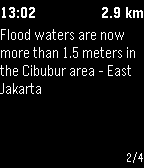

<!-- Generated by scripts/update_app_directory.py: do not edit by hand -->
[← All Pebble Developers](../developers.md)

# Tomas Holderness

*1 app · Last updated 2026-10-12 · [About these lists](../about-app-lists.md)*

Links: [Pebble App Store](https://apps.repebble.com/apps/dev/tomas-holderness_55ab352bfac4300252000048) · [GitHub (smart-facility)](https://github.com/smart-facility) · [Website (petajakarta.org)](https://petajakarta.org)

<h2 class="app-name" id="app-57b3722fbb85eddc98000636"><a href="https://apps.repebble.com/57b3722fbb85eddc98000636">FloodWatch</a> v0.5</h2>
<a class="app-source" href="https://github.com/smart-facility/cognicity-floodwatch" title="Source code" data-search-exclude>View source</a>

App

Released 2016-08-16 Updated 2019-07-24

Runs on: Time 2, Pebble 2 Duo, Pebble 2, Time, Classic

On-Hand Flood Alerts FloodWatch is a Pebble app that shows nearby reports of flooding in Jakarta, Indonesia. Reports are collected from the open source flood map PetaJakarta.org. The app lists…

