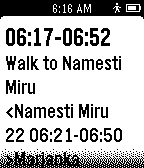

<!-- Generated by scripts/update_app_directory.py: do not edit by hand -->
[← All Pebble Developers](../developers.md)

# Tomas Ruzicka

*1 app · Last updated 2026-10-11 · [About these lists](../about-app-lists.md)*

Links: [Pebble App Store](https://apps.repebble.com/apps/dev/tomas-ruzicka_546c275071d61180ba000064) · [GitHub (LeZuse)](https://github.com/LeZuse)

<h2 class="app-name" id="app-547413c1441df0bd66000017"><a href="https://apps.repebble.com/547413c1441df0bd66000017">Transit</a> v1.0</h2>
<a class="app-source" href="https://github.com/LeZuse/pebble-transit-app" title="Source code" data-search-exclude>View source</a>

App

MIT Released 2014-11-25 Updated 2014-11-25

Runs on: Time 2, Pebble 2 Duo, Pebble 2, Time, Classic

Quick public transport search from point A to point B. Uses Google Maps Directions API. Discussion: http://bit.ly/pebble-transit Bugs: https://github.com/LeZuse/pebble-transit-app/issues

