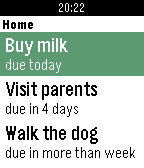

<!-- Generated by scripts/update_app_directory.py: do not edit by hand -->
[← All Pebble Developers](../developers.md)

# Tomasz Modrzyński

*1 app · Last updated 2026-10-12 · [About these lists](../about-app-lists.md)*

Links: [Pebble App Store](https://apps.repebble.com/apps/dev/tomasz-modrzy-ski_564079c9ae3ac6afa2000037) · [GitHub (modrzew)](https://github.com/modrzew)

<h2 class="app-name" id="app-56bf7fac7711eec73f00002b"><a href="https://apps.repebble.com/56bf7fac7711eec73f00002b">Tracks for Pebble</a> v1.2</h2>
<a class="app-source" href="https://github.com/modrzew/tracks-for-pebble" title="Source code" data-search-exclude>View source</a>

App

Released 2016-02-13 Updated 2016-04-12

Runs on: Time 2, Pebble 2 Duo, Pebble 2, Time, Classic

Unofficial client application for Tracks - an excellent Getting Things Done implementation. What it does: - displays list of active todos, together with due dates, - toggles between done and…

