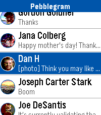
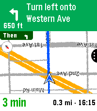

<!-- Generated by scripts/update_app_directory.py: do not edit by hand -->
[← All Pebble Developers](../developers.md)

# TomBolger

*4 apps · Last updated 2026-10-12 · [About these lists](../about-app-lists.md)*

Links: [Pebble App Store](https://apps.repebble.com/apps/dev/tombolger_0e985d2ac18230a88bcbe6b8) · [GitHub (TomBolger)](https://github.com/TomBolger)

<button type="button" data-filter="all" aria-pressed="true">All 4</button><button type="button" data-filter="watchface" aria-pressed="false" disabled>Watchfaces 0</button><button type="button" data-filter="watchapp" aria-pressed="false">Apps 4</button>

<label class="dev-sort">Sort by <select><option value="updated">Recently updated</option><option value="released">Newest release</option><option value="title">A–Z</option></select></label>

<h2 class="app-name" id="app-3f9cfd3aefd84e59a0128849"><a href="https://apps.repebble.com/3f9cfd3aefd84e59a0128849">Pebblegram</a> v3.6.0</h2>
<a class="app-source" href="https://github.com/TomBolger/Pebblegram" title="Source code" data-search-exclude>View source</a>

App · <a href="https://forum.rebble.io/t/925" title="Discuss this app on the Rebble forum" data-search-exclude>Forum thread</a>

No licence Released 2026-04-29 Updated 2026-10-07

Runs on: Round 2, Time 2, Pebble 2 Duo, Pebble 2, Time

A Telegram client for Pebble. Currently relies on a service that runs on a computer and requires some setup, and that service needs to be running for the app to work. All data and access is…

<h2 class="app-name" id="app-30bec15e3f1949deae98f21d"><a href="https://apps.repebble.com/30bec15e3f1949deae98f21d">Pebble Maps</a> v1.19.1</h2>
<a class="app-source" href="https://github.com/TomBolger/PebbleMaps" title="Source code" data-search-exclude>View source</a>

App

No licence Released 2026-10-07 Updated 2026-10-07

Runs on: Round 2, Time 2, Pebble 2 Duo, Pebble 2, Time Round, Time

Pebble Maps Google Maps on your wrist. Search for places, browse what&#x27;s nearby and get turn-by-turn directions by car, on foot, by bike or by transit, all from your Pebble. You don&#x27;t need an extra…

<h2 class="app-name" id="app-f93c30c5c5f544db8caee226"><a href="https://apps.repebble.com/f93c30c5c5f544db8caee226">Notification Sync</a> v2.0</h2>
<a class="app-source" href="https://github.com/TomBolger/NotificationSync" title="Source code" data-search-exclude>View source</a>

App

Apache-2.0 Released 2026-10-07 Updated 2026-10-07

Runs on: Round 2, Time 2, Pebble 2 Duo, Pebble 2, Time

Have you ever been annoyed that your watch notifications were a separate storage bucket of stale notices you may have already seen on your phone? Ever swap to an Android watch and miss the…

<h2 class="app-name" id="app-0d3a55a0696e4bc38724f369"><a href="https://apps.repebble.com/0d3a55a0696e4bc38724f369">Billy</a> v0.4</h2>
<a class="app-source" href="https://github.com/TomBolger/Billy" title="Source code" data-search-exclude>View source</a>

App

Apache-2.0 Released 2026-10-07 Updated 2026-10-07

Runs on: Round 2, Time 2, Pebble 2 Duo, Pebble 2, Time Round, Time

Billy is a spiritual successor to the legendary Bobby, itself an homage to the mythical Snowy the Dog. Katherine Berry has stepped away from Pebble development, but she generously left Bobby open…

