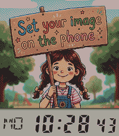
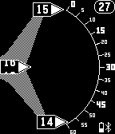

<!-- Generated by scripts/update_app_directory.py: do not edit by hand -->
[← All Pebble Developers](../developers.md)

# TomHol

*2 watchfaces · Last updated 2026-10-12 · [About these lists](../about-app-lists.md)*

Links: [Pebble App Store](https://apps.repebble.com/apps/dev/tomhol_546bbedb71d611761800000f) · [GitHub (czmanix)](https://github.com/czmanix)

<button type="button" data-filter="all" aria-pressed="true">All 2</button><button type="button" data-filter="watchface" aria-pressed="false">Watchfaces 2</button><button type="button" data-filter="watchapp" aria-pressed="false" disabled>Apps 0</button>

<label class="dev-sort">Sort by <select><option value="updated">Recently updated</option><option value="released">Newest release</option><option value="title">A–Z</option></select></label>

<h2 class="app-name" id="app-b1ebccd7b52d49e0aff30b44"><a href="https://apps.repebble.com/b1ebccd7b52d49e0aff30b44">PhotoWatch</a> v1.0.6</h2>
<a class="app-source" href="https://github.com/czmanix/tomhol-configs/tree/main/photowatch" title="Source code" data-search-exclude>View source</a>

Watchface

No licence Released 2026-07-19 Updated 2026-07-27

Runs on: Round 2, Time 2

A watchface that lets you use any photo you want and gives you all the tools to make it look perfect on the Pebble&#x27;s e-paper display. Use Any Image: Upload a photo from your phone or paste a URL…

<h2 class="app-name" id="app-551413fd369eea6b910000c5"><a href="https://apps.repebble.com/551413fd369eea6b910000c5">DigiRotate</a> v1.26</h2>
<a class="app-source" href="https://github.com/czmanix/DigiRotate" title="Source code" data-search-exclude>View source</a>

Watchface

No licence Released 2015-03-26 Updated 2015-03-31

Runs on: Time 2, Pebble 2 Duo, Pebble 2, Time, Classic

Rotating digital watch based on a Reddit request. Original mechanical watch is this: http://imgur.com/gallery/XdjPP7R

