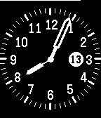

<!-- Generated by scripts/update_app_directory.py: do not edit by hand -->
[← All Pebble Developers](../developers.md)

# Tommy S-Andreassen

*1 watchface · Last updated 2026-10-12 · [About these lists](../about-app-lists.md)*

Links: [Pebble App Store](https://apps.repebble.com/apps/dev/tommy-s-andreassen_56fd477e6266bfa84f000041) · [GitHub (snymainn)](https://github.com/snymainn)

<h2 class="app-name" id="app-5736153f9f823cb89300000f"><a href="https://apps.repebble.com/5736153f9f823cb89300000f">Minimalist Analog</a> v0.7</h2>
<a class="app-source" href="https://github.com/snymainn/minimalist-pebble" title="Source code" data-search-exclude>View source</a>

Watchface

Released 2016-05-13 Updated 2016-05-17

Runs on: Time 2, Pebble 2 Duo, Pebble 2, Time, Classic

Simple analog watchface with battery and connection status. The hands and markings are cloned from Engineering watchface by @nguyer. I have added a large date number that is easier to read. On the…

