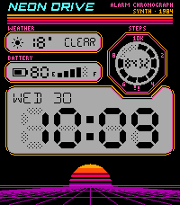

<!-- Generated by scripts/update_app_directory.py: do not edit by hand -->
[← All Pebble Developers](../developers.md)

# Tompori

*1 watchface · Last updated 2026-10-26 · [About these lists](../about-app-lists.md)*

Links: [Pebble App Store](https://apps.repebble.com/apps/dev/tompori_014546e6819631ab0afcb9bd) · [GitHub (tompori)](https://github.com/tompori)

<h2 class="app-name" id="app-2e6c267ad7ed47fc89646031"><a href="https://apps.repebble.com/2e6c267ad7ed47fc89646031">Neon Drive</a> v1.0.0</h2>
<a class="app-source" href="https://github.com/tompori/pebble-watchfaces" title="Source code" data-search-exclude>View source</a>

Watchface

No licence Released 2026-10-24 Updated 2026-10-24

Runs on: Time 2

An 80s digital watch on a synthwave night drive. A black Casio-style body with printed rally stripes holds grey LCD windows with real segment digits, faint unlit segments included, above a banded…

