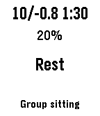

<!-- Generated by scripts/update_app_directory.py: do not edit by hand -->
[← All Pebble Developers](../developers.md)

# Toni Magni

*1 watchface · Last updated 2026-10-11 · [About these lists](../about-app-lists.md)*

Links: [Rebble App Store](https://apps.rebble.io/en_US/developer/6676a3b1ffe1740009aa40f6/1) · [GitHub (zgypa)](https://github.com/zgypa) · [Website (antoniomagni.com)](https://www.antoniomagni.com)

<h2 class="app-name" id="app-6996ab1b36c3420009e9c780"><a href="https://apps.rebble.io/en_US/application/6996ab1b36c3420009e9c780">Vipassana</a> v0.3</h2>
<a class="app-source" href="https://github.com/zgypa/pebble-vipassana" title="Source code" data-search-exclude>View source</a>

Watchface

Released 2026-02-19 Updated 2026-02-19 Rebble App Store

Runs on: Time 2, Pebble 2 Duo, Pebble 2, Time, Classic

Vipassana - Meditation Course Watchface A minimalist watchface for students and servers attending Vipassana meditation courses (as taught by S.N. Goenka). KEY FEATURES: • Decimal countdown showing…

