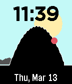

<!-- Generated by scripts/update_app_directory.py: do not edit by hand -->
[← All Pebble Developers](../developers.md)

# Tony Atkins

*2 watchfaces · Last updated 2026-10-11 · [About these lists](../about-app-lists.md)*

Links: [Pebble App Store](https://apps.repebble.com/apps/dev/tony-atkins_679bbba532bc7d0009dd4fdc) · [GitHub (duhrer)](https://github.com/duhrer) · [Website (duhrer.github.io)](https://duhrer.github.io/)

<button type="button" data-filter="all" aria-pressed="true">All 2</button><button type="button" data-filter="watchface" aria-pressed="false">Watchfaces 2</button><button type="button" data-filter="watchapp" aria-pressed="false" disabled>Apps 0</button>

<label class="dev-sort">Sort by <select><option value="updated">Recently updated</option><option value="released">Newest release</option><option value="title">A–Z</option></select></label>

<h2 class="app-name" id="app-67d405d0f4b49d00099ff85d"><a href="https://apps.repebble.com/67d405d0f4b49d00099ff85d">Vertin</a> v1.0</h2>
<a class="app-source" href="https://github.com/duhrer/pebble-vertin-c" title="Source code" data-search-exclude>View source</a>

Watchface

Released 2025-03-14 Updated 2025-03-14

Runs on: Round 2, Time 2, Pebble 2 Duo, Pebble 2, Time Round, Time

The second hand inverts the colours as it moves. The colours are configurable, and there&#x27;s an optional &quot;night mode&quot; you can configure to use different colours at night.

<h2 class="app-name" id="app-67c9a27dd2acb301d72977c7"><a href="https://apps.repebble.com/67c9a27dd2acb301d72977c7">Sisyphus</a> v1.1</h2>
<a class="app-source" href="https://github.com/duhrer/pebble-sisyphus-watchface" title="Source code" data-search-exclude>View source</a>

Watchface

Released 2025-03-06 Updated 2025-03-13

Runs on: Round 2, Time 2, Pebble 2 Duo, Pebble 2, Time Round, Time, Classic

Sisyphus is the second hand, he climbs the mountain every minute, only to fall back below and start over.

