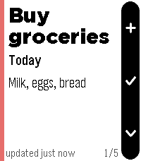

<!-- Generated by scripts/update_app_directory.py: do not edit by hand -->
[← All Pebble Developers](../developers.md)

# Tools on Tech

*1 app · Last updated 2026-10-12 · [About these lists](../about-app-lists.md)*

Links: [Pebble App Store](https://apps.repebble.com/apps/dev/tools-on-tech_09d07916bc53b30ede8f8320) · [GitLab (tools-on-tech)](https://gitlab.com/tools-on-tech)

<h2 class="app-name" id="app-10f3dfb18e4d4256824ad844"><a href="https://apps.repebble.com/10f3dfb18e4d4256824ad844">QuickTodoist</a> v1.5.3</h2>
<a class="app-source" href="https://gitlab.com/tools-on-tech/quicktodoist" title="Source code" data-search-exclude>View source</a>

App · <a href="https://forum.rebble.io/t/1186" title="Discuss this app on the Rebble forum" data-search-exclude>Forum thread</a>

Released 2026-08-01 Updated 2026-08-05

Runs on: Round 2, Time 2, Pebble 2 Duo, Pebble 2, Time Round, Time, Classic

I wanted a Todoist app that would start instantly. So this setup uses an api key and cache to make that possible. It&#x27;s meant for me to quickly check my current top tasks and add thoughts…

