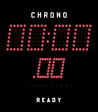
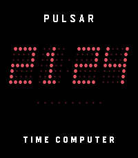

<!-- Generated by scripts/update_app_directory.py: do not edit by hand -->
[← All Pebble Developers](../developers.md)

# Torabaasu

*1 watchface and 1 app · Last updated 2026-10-12 · [About these lists](../about-app-lists.md)*

Links: [Pebble App Store](https://apps.repebble.com/apps/dev/torabaasu_6a88b50c4b542c00088bca2f) · [GitHub (tmcinerney)](https://github.com/tmcinerney) · [Website (trav.sh)](https://trav.sh)

<button type="button" data-filter="all" aria-pressed="true">All 2</button><button type="button" data-filter="watchface" aria-pressed="false">Watchfaces 1</button><button type="button" data-filter="watchapp" aria-pressed="false">Apps 1</button>

<label class="dev-sort">Sort by <select><option value="updated">Recently updated</option><option value="released">Newest release</option><option value="title">A–Z</option></select></label>

<h2 class="app-name" id="app-6a8bc61f06d13300097edc49"><a href="https://apps.repebble.com/6a8bc61f06d13300097edc49">Pulsar Chronograph</a> v1.1.0</h2>
<a class="app-source" href="https://github.com/tmcinerney/pebble-pulsar/tree/main/apps/chrono" title="Source code" data-search-exclude>View source</a>

App · <a href="https://forum.rebble.io/t/1275" title="Discuss this app on the Rebble forum" data-search-exclude>Forum thread</a>

Released 2026-08-24 Updated 2026-08-24

Runs on: Time 2, Pebble 2 Duo, Pebble 2, Time, Classic

Pulsar Chrono is a high-performance digital chronograph and split-lap stopwatch for Pebble OS styled after vintage 1970s solid-state LED timing instruments. TIMING FEATURES: • Centisecond…

<h2 class="app-name" id="app-6a8937de8c7604000985e6e2"><a href="https://apps.repebble.com/6a8937de8c7604000985e6e2">Pulsar 1970</a> v2.2.0</h2>
<a class="app-source" href="https://github.com/tmcinerney/pebble-pulsar" title="Source code" data-search-exclude>View source</a>

Watchface · <a href="https://forum.rebble.io/t/1266" title="Discuss this app on the Rebble forum" data-search-exclude>Forum thread</a>

Released 2026-08-22 Updated 2026-08-24

Runs on: Time 2, Pebble 2 Duo, Pebble 2, Time, Classic

The original 1972 Hamilton Pulsar &quot;Time Computer&quot; was the world’s first all-electronic digital wristwatch. Pulsar 1970 brings this horological icon to Pebble with exacting historical fidelity. ⚡…

