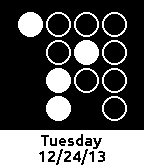

<!-- Generated by scripts/update_app_directory.py: do not edit by hand -->
[← All Pebble Developers](../developers.md)

# Tory Gaurnier

*2 watchfaces · Last updated 2026-10-11 · [About these lists](../about-app-lists.md)*

Links: [Pebble App Store](https://apps.repebble.com/apps/dev/tory-gaurnier_52b8d10bfd4763023e000018) · [GitHub (tgaurnier)](https://github.com/tgaurnier)

<button type="button" data-filter="all" aria-pressed="true">All 2</button><button type="button" data-filter="watchface" aria-pressed="false">Watchfaces 2</button><button type="button" data-filter="watchapp" aria-pressed="false" disabled>Apps 0</button>

<label class="dev-sort">Sort by <select><option value="updated">Recently updated</option><option value="released">Newest release</option><option value="title">A–Z</option></select></label>

<h2 class="app-name" id="app-52ba053d7a3fe9f7ae000007"><a href="https://apps.repebble.com/52ba053d7a3fe9f7ae000007">Weather Face</a> v1.0.7</h2>
<a class="app-source" href="https://github.com/tgaurnier/WeatherFace" title="Source code" data-search-exclude>View source</a>

Watchface

Released 2013-12-24 Updated 2013-12-29

Runs on: Time 2, Pebble 2 Duo, Pebble 2, Time, Classic

A simple weather watch face, shows location and weather. Uses Open Weather Map for data. Built with SDK 2.0, and is configurable via Android or iOS Pebble app.

<h2 class="app-name" id="app-52b9f8dcb570e5507e000002"><a href="https://apps.repebble.com/52b9f8dcb570e5507e000002">Bit Face</a> v1.0.1</h2>
<a class="app-source" href="https://github.com/tgaurnier/BitFace" title="Source code" data-search-exclude>View source</a>

Watchface

Released 2013-12-24 Updated 2013-12-29

Runs on: Time 2, Pebble 2 Duo, Pebble 2, Time, Classic

A binary watch face with date, inspired by Bikron, and modeled on Just A Bit, made with SDK 2.0. Uses Ubuntu bold font for date. When in 24 Hour mode there will be 2 bits in the first hour…

