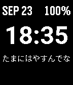

<!-- Generated by scripts/update_app_directory.py: do not edit by hand -->
[← All Pebble Developers](../developers.md)

# Toshiaki1973

*2 watchfaces · Last updated 2026-10-12 · [About these lists](../about-app-lists.md)*

Links: [Pebble App Store](https://apps.repebble.com/apps/dev/toshiaki1973_3d1c3936fafe6c3ee52664f7) · [GitHub (Toshiaki1973)](https://github.com/Toshiaki1973)

<button type="button" data-filter="all" aria-pressed="true">All 2</button><button type="button" data-filter="watchface" aria-pressed="false">Watchfaces 2</button><button type="button" data-filter="watchapp" aria-pressed="false" disabled>Apps 0</button>

<label class="dev-sort">Sort by <select><option value="updated">Recently updated</option><option value="released">Newest release</option><option value="title">A–Z</option></select></label>

<h2 class="app-name" id="app-b271e5b38f5f49deb9e84fdf"><a href="https://apps.repebble.com/b271e5b38f5f49deb9e84fdf">it&#x27;s cool</a> v1.0.1</h2>
<a class="app-source" href="https://github.com/Toshiaki1973/pebble-its-cool" title="Source code" data-search-exclude>View source</a>

Watchface

Other Released 2026-09-24 Updated 2026-09-24

Runs on: Pebble 2 Duo

スイス鉄道時計風のアナログ時計。先端が丸い秒針が毎秒動く。日付・バッテリー残量も表示。

<h2 class="app-name" id="app-0ded87a9da8841db85b20176"><a href="https://apps.repebble.com/0ded87a9da8841db85b20176">mimikko</a> v1.0.0</h2>
<a class="app-source" href="https://github.com/Toshiaki1973/pebble-mimikko" title="Source code" data-search-exclude>View source</a>

Watchface

Other Released 2026-09-23 Updated 2026-09-23

Runs on: Pebble 2 Duo

関西弁でひとことつぶやく、常時装着型の一方通行ペット時計。日付・時計・バッテリー残量も表示。

