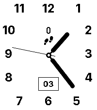
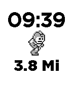

<!-- Generated by scripts/update_app_directory.py: do not edit by hand -->
[← All Pebble Developers](../developers.md)

# townmath

*2 watchfaces · Last updated 2026-10-11 · [About these lists](../about-app-lists.md)*

Links: [Pebble App Store](https://apps.repebble.com/apps/dev/townmath_56df90d4774abcde2800003d) · [GitHub (townmath)](https://github.com/townmath)

<button type="button" data-filter="all" aria-pressed="true">All 2</button><button type="button" data-filter="watchface" aria-pressed="false">Watchfaces 2</button><button type="button" data-filter="watchapp" aria-pressed="false" disabled>Apps 0</button>

<label class="dev-sort">Sort by <select><option value="updated">Recently updated</option><option value="released">Newest release</option><option value="title">A–Z</option></select></label>

<h2 class="app-name" id="app-ff769e6cc50848f589dade12"><a href="https://apps.repebble.com/ff769e6cc50848f589dade12">Pear Hermit California</a> v1.0.2</h2>
<a class="app-source" href="https://github.com/townmath/pear-hermit-ca-pebble" title="Source code" data-search-exclude>View source</a>

Watchface

Released 2026-06-03 Updated 2026-06-03

Runs on: Time 2

Analog watch face with configurable colors and activity display.

<h2 class="app-name" id="app-56f430f6acd3890dde000006"><a href="https://apps.repebble.com/56f430f6acd3890dde000006">RunningFace</a> v1.4</h2>
<a class="app-source" href="https://github.com/townmath/RunningFace" title="Source code" data-search-exclude>View source</a>

Watchface

Released 2016-03-24 Updated 2016-03-27

Runs on: Round 2, Time 2, Pebble 2 Duo, Pebble 2, Time Round, Time, Classic

Shows time and approximate distance traveled in miles.

