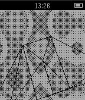

<!-- Generated by scripts/update_app_directory.py: do not edit by hand -->
[← All Pebble Developers](../developers.md)

# tox

*1 app · Last updated 2026-10-12 · [About these lists](../about-app-lists.md)*

Links: [Pebble App Store](https://apps.repebble.com/apps/dev/tox_55d2a6eea9146f7cd6000068) · [GitHub (mtoksvig)](https://github.com/mtoksvig)

<h2 class="app-name" id="app-55da2dff260e9cc5a2000031"><a href="https://apps.repebble.com/55da2dff260e9cc5a2000031">thumpa</a> v1.1</h2>
<a class="app-source" href="http://github.com/mtoksvig/cloud-thumpa" title="Source code" data-search-exclude>View source</a>

App

No licence Released 2015-08-23 Updated 2015-08-23

Runs on: Time 2, Pebble 2 Duo, Pebble 2, Time, Classic

plasma and spinning 3D wireframe

