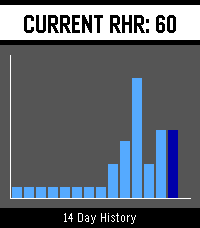

<!-- Generated by scripts/update_app_directory.py: do not edit by hand -->
[← All Pebble Developers](../developers.md)

# ToyFraz

*1 app · Last updated 2026-10-12 · [About these lists](../about-app-lists.md)*

Links: [Rebble App Store](https://apps.rebble.io/en_US/developer/690d12be3399bf0009b60d10/1) · [GitHub (ToyFraz)](https://github.com/ToyFraz)

<h2 class="app-name" id="app-69fd0a1a0c32da000906f9f9"><a href="https://apps.rebble.io/en_US/application/69fd0a1a0c32da000906f9f9">RHR Tracker</a> v1.66.0</h2>
<a class="app-source" href="https://github.com/ToyFraz/RHR-tracker" title="Source code" data-search-exclude>View source</a>

App · <a href="https://forum.rebble.io/t/956" title="Discuss this app on the Rebble forum" data-search-exclude>Forum thread</a>

MIT Released 2026-05-07 Updated 2026-05-13 Rebble App Store

Runs on: Time 2

The app uses the information already gathered by Pebble Health, so it is very lightweight. It takes the heartrate measurements from the night before from 12:00 until 4:00 am. It discards any…

