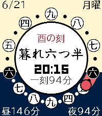
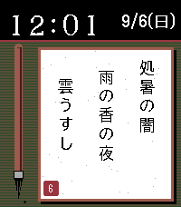

<!-- Generated by scripts/update_app_directory.py: do not edit by hand -->
[← All Pebble Developers](../developers.md)

# toyon

*2 watchfaces · Last updated 2026-11-02 · [About these lists](../about-app-lists.md)*

Links: [Pebble App Store](https://apps.repebble.com/apps/dev/toyon_e9f36cde6997506783df5053) · [GitHub (Toyontaker)](https://github.com/Toyontaker)

<button type="button" data-filter="all" aria-pressed="true">All 2</button><button type="button" data-filter="watchface" aria-pressed="false">Watchfaces 2</button><button type="button" data-filter="watchapp" aria-pressed="false" disabled>Apps 0</button>

<label class="dev-sort">Sort by <select><option value="updated">Recently updated</option><option value="released">Newest release</option><option value="title">A–Z</option></select></label>

<h2 class="app-name" id="app-8513f6d660394c36934478d5"><a href="https://apps.repebble.com/8513f6d660394c36934478d5">Wadokei</a> v1.0.2</h2>
<a class="app-source" href="https://github.com/Toyontaker/pebble-wadokei-face" title="Source code" data-search-exclude>View source</a>

Watchface

Other Released 2026-10-12 Updated 2026-10-13

Runs on: Round 2, Time 2, Pebble 2 Duo, Pebble 2, Time Round, Time

A Japanese temporal-hour watchface: day and night are each split into six, so the hours stretch and shrink with the seasons. 日の出・日の入りから昼と夜を六等分する、江戸の不定時法のウォッチフェイス。 A watchface that tells time the…

<h2 class="app-name" id="app-93a8f5f759a7428e8ba88245"><a href="https://apps.repebble.com/93a8f5f759a7428e8ba88245">Haiku-face</a> v1.6.1</h2>
<a class="app-source" href="https://github.com/Toyontaker/pebble-haiku-face" title="Source code" data-search-exclude>View source</a>

Watchface

No licence Released 2026-09-06 Updated 2026-10-13

Runs on: Round 2, Time 2, Pebble 2 Duo, Pebble 2, Time Round, Time

いまの季節・天気・時間帯を、LLM が一句に詠むウォッチフェイス。 A watchface that turns this moment — season, weather, time of day — into a haiku written by an LLM. 短冊と筆をあしらった和風のウォッチフェイスです。 Claude または ChatGPT…

