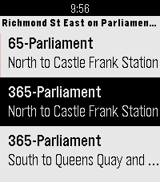

<!-- Generated by scripts/update_app_directory.py: do not edit by hand -->
[← All Pebble Developers](../developers.md)

# TransSee

*1 app · Last updated 2026-10-12 · [About these lists](../about-app-lists.md)*

Links: [Pebble App Store](https://apps.repebble.com/apps/dev/transsee_2ffdcb53524bc35b242d3209) · [GitHub (doconnoronca)](https://github.com/doconnoronca) · [Website (transsee.ca)](https://www.transsee.ca/)

<h2 class="app-name" id="app-f88025a5c8794321acb050e7"><a href="https://apps.repebble.com/f88025a5c8794321acb050e7">TransSee Transit Time</a> v2.0.6</h2>
<a class="app-source" href="https://github.com/doconnoronca/toronto-transit-time" title="Source code" data-search-exclude>View source</a>

App

MIT Released 2026-05-30 Updated 2026-09-14

Runs on: Round 2, Time 2, Pebble 2 Duo, Pebble 2, Time Round, Time, Classic

Real-time transit arrival predictions for more than 200 transit agencies across Canada, US and around the world. See www.transsee.ca for the complete list. Currently requires TransSee Premium…

