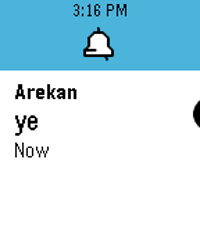

<!-- Generated by scripts/update_app_directory.py: do not edit by hand -->
[← All Pebble Developers](../developers.md)

# Trevir

*2 apps · Last updated 2026-10-11 · [About these lists](../about-app-lists.md)*

Links: [Rebble App Store](https://apps.rebble.io/en_US/developer/56db39b3d86927b35f00002c/1) · [GitHub (Cellomonster)](https://github.com/Cellomonster) · [Website (twitter.com)](https://twitter.com/trev3d)

<button type="button" data-filter="all" aria-pressed="true">All 2</button><button type="button" data-filter="watchface" aria-pressed="false" disabled>Watchfaces 0</button><button type="button" data-filter="watchapp" aria-pressed="false">Apps 2</button>

<label class="dev-sort">Sort by <select><option value="updated">Recently updated</option><option value="released">Newest release</option><option value="title">A–Z</option></select></label>

<h2 class="app-name" id="app-605cb7441342ae00bc1202ed"><a href="https://apps.rebble.io/en_US/application/605cb7441342ae00bc1202ed">Send Discord Message</a> v1.0</h2>
<a class="app-source" href="https://github.com/Cellomonster/discord-pebble" title="Source code" data-search-exclude>View source</a>

App

MIT Released 2021-03-25 Updated 2021-03-25 Rebble App Store

Runs on: Round 2, Time 2, Pebble 2 Duo, Pebble 2, Time Round, Time

Send messages to Discord users in your DMs list. Useful for quickly replying to notifications. Works similarly to the built-in Send Text app. Conversations are sorted by recent activity. Using…

<h2 class="app-name" id="app-59616c500dfc32af6100131c"><a href="https://apps.rebble.io/en_US/application/59616c500dfc32af6100131c">Discord</a> v8.0</h2>
<a class="app-source" href="https://github.com/Cellomonster/Discord-for-Pebble" title="Source code" data-search-exclude>View source</a>

App

MIT Released 2017-07-08 Updated 2017-09-13 Rebble App Store

Runs on: Round 2, Time 2, Time Round, Time

Discord for Pebble is an unofficial Discord client for your Pebble smartwatch. The client can send messages through your account on Discord servers that you are a member of through voice. If you…

