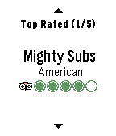

<!-- Generated by scripts/update_app_directory.py: do not edit by hand -->
[← All Pebble Developers](../developers.md)

# TripAdvisor LLC

*1 app · Last updated 2026-10-11 · [About these lists](../about-app-lists.md)*

Links: [Rebble App Store](https://apps.rebble.io/en_US/developer/54cbf5780a912f8eb8000022/1) · [Website (tripadvisor.com)](http://www.tripadvisor.com)

<h2 class="app-name" id="app-5509b04684ad023da7000030"><a href="https://apps.rebble.io/en_US/application/5509b04684ad023da7000030">TripAdvisor</a> v2.2-rbl1</h2>
<a class="app-source" href="http://developer-tripadvisor.com/content-api/" title="Source code" data-search-exclude>View source</a>

App

Released 2015-03-18 Updated 2019-07-24 Rebble App Store

Runs on: Round 2, Time 2, Pebble 2 Duo, Pebble 2, Time Round, Time, Classic

Millions of restaurants and traveler reviews available right on your wrist. TripAdvisor for Pebble makes it easy to find great places to eat, wherever you go. Français Des millions de restaurants…

