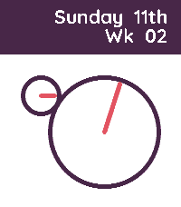
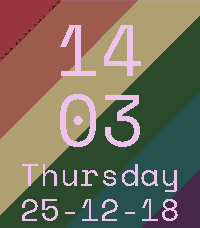
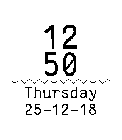
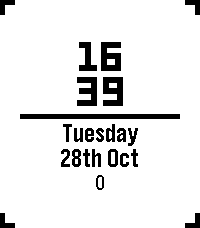

<!-- Generated by scripts/update_app_directory.py: do not edit by hand -->
[← All Pebble Developers](../developers.md)

# Tripplehelix

*5 watchfaces · Last updated 2026-10-12 · [About these lists](../about-app-lists.md)*

Links: [Rebble App Store](https://apps.rebble.io/en_US/developer/687d60c735f0cc0009d17719/1) · [Codeberg (tripplehelix)](https://codeberg.org/tripplehelix) · [Website (helix.me.uk)](https://helix.me.uk/)

<button type="button" data-filter="all" aria-pressed="true">All 5</button><button type="button" data-filter="watchface" aria-pressed="false">Watchfaces 5</button><button type="button" data-filter="watchapp" aria-pressed="false" disabled>Apps 0</button>

<label class="dev-sort">Sort by <select><option value="updated">Recently updated</option><option value="released">Newest release</option><option value="title">A–Z</option></select></label>

<h2 class="app-name" id="app-6963bcb26da27100098f332d"><a href="https://apps.rebble.io/en_US/application/6963bcb26da27100098f332d">Helix-Analog</a> v1.1</h2>
<a class="app-source" href="https://codeberg.org/tripplehelix/Helix-Pebble/src/branch/main/Helix-Analog" title="Source code" data-search-exclude>View source</a>

Watchface · <a href="https://forum.rebble.io/t/480" title="Discuss this app on the Rebble forum" data-search-exclude>Forum thread</a>

Released 2026-01-11 Updated 2026-01-11 Rebble App Store

Runs on: Time 2

A normal 12 hour clock, but the hands are split into their own faces. The hour hand &#x27;ticks&#x27; across the numbers for visibility, read the time as if it was a digital watch. Font: Quicksand (OFL)

<h2 class="app-name" id="app-69440a53ce101c0009f53014"><a href="https://apps.rebble.io/en_US/application/69440a53ce101c0009f53014">Helix-Gay</a> v1.0</h2>
<a class="app-source" href="https://codeberg.org/tripplehelix/Helix-Pebble/src/branch/main/Helix-Gay" title="Source code" data-search-exclude>View source</a>

Watchface · <a href="https://forum.rebble.io/t/298" title="Discuss this app on the Rebble forum" data-search-exclude>Forum thread</a>

Released 2025-12-18 Updated 2025-12-18 Rebble App Store

Runs on: Time 2

A simple face to show off your gay! You also get a lovely surprise on the hour. Date is YY-MM-DD

<h2 class="app-name" id="app-68ebf4925536590009a4034f"><a href="https://apps.rebble.io/en_US/application/68ebf4925536590009a4034f">Helix-Clean</a> v1.4</h2>
<a class="app-source" href="https://codeberg.org/tripplehelix/Helix-Pebble/src/branch/main/Helix-Clean" title="Source code" data-search-exclude>View source</a>

Watchface · <a href="https://forum.rebble.io/t/295" title="Discuss this app on the Rebble forum" data-search-exclude>Forum thread</a>

Released 2025-10-12 Updated 2025-12-18 Rebble App Store

Runs on: Time 2, Pebble 2 Duo, Pebble 2, Time, Classic

A clean and simple face, with the battery displayed as the wiggly line. Date is Y-M-D Fonts; FantasqueSansMono - SIL Open Font

<h2 class="app-name" id="app-68aa17632dfa4d0009a22828"><a href="https://apps.rebble.io/en_US/application/68aa17632dfa4d0009a22828">Helix-Simple</a> v1.4</h2>
<a class="app-source" href="https://codeberg.org/tripplehelix/Helix-Pebble/src/branch/main/Helix-Simple" title="Source code" data-search-exclude>View source</a>

Watchface

Released 2025-08-23 Updated 2025-11-08 Rebble App Store

Runs on: Round 2, Time 2, Pebble 2 Duo, Pebble 2, Time Round, Time, Classic

A simple watch face for simple people. The bar in the centre is your battery percentage and the numbers at the bottom are step count.

<h2 class="app-name" id="app-690f681efa41010009584db6"><a href="https://apps.rebble.io/en_US/application/690f681efa41010009584db6">Helix-Business</a> v1.1</h2>
<a class="app-source" href="https://codeberg.org/tripplehelix/Helix-Pebble/src/branch/main/Helix-Business" title="Source code" data-search-exclude>View source</a>

Watchface

Released 2025-11-08 Updated 2025-11-08 Rebble App Store

Runs on: Round 2, Time 2, Pebble 2 Duo, Pebble 2, Time Round, Time, Classic

A very basic, very business, very low power face. Just shows the date and week number, updates daily. Apparently it can be better to not know the precise time, allowing you to be more present and…

