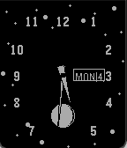
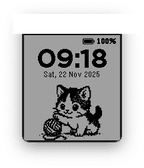

<!-- Generated by scripts/update_app_directory.py: do not edit by hand -->
[← All Pebble Developers](../developers.md)

# trishtzy

*3 watchfaces · Last updated 2026-10-12 · [About these lists](../about-app-lists.md)*

Links: [Pebble App Store](https://apps.repebble.com/apps/dev/trishtzy_7f804afab74d6b22653f0e98) · [GitHub (trishtzy)](https://github.com/trishtzy)

<button type="button" data-filter="all" aria-pressed="true">All 3</button><button type="button" data-filter="watchface" aria-pressed="false">Watchfaces 3</button><button type="button" data-filter="watchapp" aria-pressed="false" disabled>Apps 0</button>

<label class="dev-sort">Sort by <select><option value="updated">Recently updated</option><option value="released">Newest release</option><option value="title">A–Z</option></select></label>

<h2 class="app-name" id="app-3973ba5aa4a04256a384422d"><a href="https://apps.repebble.com/3973ba5aa4a04256a384422d">Moonphase</a> v1.0.1</h2>
<a class="app-source" href="https://github.com/trishtzy/pebble" title="Source code" data-search-exclude>View source</a>

Watchface

Released 2026-05-04 Updated 2026-08-29

Runs on: Round 2, Time 2, Pebble 2 Duo, Pebble 2, Time Round, Time, Classic

An analog watchface with day/night mode: a blue sky with clouds and sun by day, a starry sky with a live moon phase subdial by night.

<h2 class="app-name" id="app-9d2ad00e3f5f439a9396316c"><a href="https://apps.repebble.com/9d2ad00e3f5f439a9396316c">Meow O&#x27;Clock</a> v1.4.0</h2>
<a class="app-source" href="https://github.com/trishtzy/pebble" title="Source code" data-search-exclude>View source</a>

Watchface · <a href="https://forum.rebble.io/t/1286" title="Discuss this app on the Rebble forum" data-search-exclude>Forum thread</a>

Released 2026-04-28 Updated 2026-08-29

Runs on: Time 2, Pebble 2 Duo, Pebble 2, Time, Classic

A playful watchface featuring an animated kitten that switches between playtime and sleeping mode based on the time of day, with clean time and date display. Includes battery status indicator with…

<h2 class="app-name" id="app-78297d14b6bd426799b7d759"><a href="https://apps.repebble.com/78297d14b6bd426799b7d759">Lemming Brothers</a> v1.0.0</h2>
<a class="app-source" href="https://github.com/trishtzy/pebble" title="Source code" data-search-exclude>View source</a>

Watchface

Released 2026-08-29 Updated 2026-08-29

Runs on: Time 2, Pebble 2 Duo, Pebble 2, Time

The Lemming Brothers bank is open for business — and time is money. A tiny analog clock is set into the facade of the venerable Lemming Brothers bank, keeping the hours with proper hands on a…

