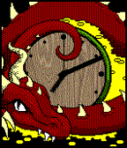

<!-- Generated by scripts/update_app_directory.py: do not edit by hand -->
[← All Pebble Developers](../developers.md)

# Tristan Schorn

*1 watchface · Last updated 2026-10-12 · [About these lists](../about-app-lists.md)*

Links: [Pebble App Store](https://apps.repebble.com/apps/dev/tristan-schorn_54136821ecb612dca700010a) · [GitHub (schornT)](https://github.com/schornT) · [Website (tristanschorn.wordpress.com)](https://tristanschorn.wordpress.com/)

<h2 class="app-name" id="app-55de2dc8785abd1c3c000075"><a href="https://apps.repebble.com/55de2dc8785abd1c3c000075">Dragon Clock Reborn</a> v1.1</h2>
<a class="app-source" href="https://github.com/schornT/watch-dragon" title="Source code" data-search-exclude>View source</a>

Watchface

Released 2015-08-26 Updated 2015-09-08

Runs on: Time 2, Pebble 2 Duo, Pebble 2, Time, Classic

The mighty dragon guards its wealth. This is a remake of an old watchface by Bit Hangar. Original artwork and code by Bit Hangar, updated code and artwork by Tristan Schorn and Mitchel Matthews…

