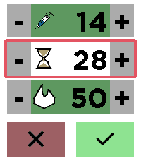

<!-- Generated by scripts/update_app_directory.py: do not edit by hand -->
[← All Pebble Developers](../developers.md)

# Tristan

*1 app · Last updated 2026-11-09 · [About these lists](../about-app-lists.md)*

Links: [Pebble App Store](https://apps.repebble.com/apps/dev/tristan_142b9f2ddddabc1c79ad3036) · [GitHub (consp)](https://github.com/consp)

<h2 class="app-name" id="app-50ba0b86d22d4b558332d016"><a href="https://apps.repebble.com/50ba0b86d22d4b558332d016">xDrip Treatment App</a> v0.2.0</h2>
<a class="app-source" href="https://github.com/consp/xDrip-Pebble-Treatment-app" title="Source code" data-search-exclude>View source</a>

App

No licence Released 2026-10-25 Updated 2026-11-02

Runs on: Round 2, Time 2, Time

This app uses the xDrip Pebble framework to send treatment data to the xDrip app. IMPORTANT NOTICE: A custom xDrip version is currently required, see…

