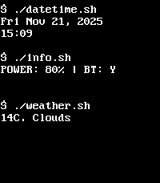

<!-- Generated by scripts/update_app_directory.py: do not edit by hand -->
[← All Pebble Developers](../developers.md)

# Tsuharesu

*1 watchface · Last updated 2026-10-12 · [About these lists](../about-app-lists.md)*

Links: [Pebble App Store](https://apps.repebble.com/apps/dev/tsuharesu_54d74652513e9cab7d00008b) · [GitHub (tsuharesu)](https://github.com/tsuharesu) · [Website (tsuharesu.com)](https://tsuharesu.com)

<h2 class="app-name" id="app-581dfbb39cbbaf50a50001c5"><a href="https://apps.repebble.com/581dfbb39cbbaf50a50001c5">datetime.sh</a> v2.0</h2>
<a class="app-source" href="https://github.com/tsuharesu/codespaces-pebble/tree/main/datetime-sh" title="Source code" data-search-exclude>View source</a>

Watchface

Released 2016-11-05 Updated 2025-11-21

Runs on: Time 2, Pebble 2 Duo, Pebble 2, Time, Classic

datetime.sh is a sleek, terminal-inspired watchface that brings retro command-line aesthetics to your Pebble smartwatch. Display real-time date, time, and weather information alongside your…

