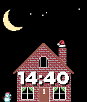
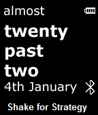
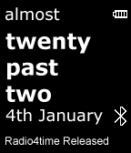

<!-- Generated by scripts/update_app_directory.py: do not edit by hand -->
[← All Pebble Developers](../developers.md)

# TTV69

*4 watchfaces · Last updated 2026-10-11 · [About these lists](../about-app-lists.md)*

Links: [Pebble App Store](https://apps.repebble.com/apps/dev/ttv69_52bc7111db1360a630000154) · [GitHub (TTV)](https://github.com/TTV) · [Website (cleggo.co.uk)](http://cleggo.co.uk)

<button type="button" data-filter="all" aria-pressed="true">All 4</button><button type="button" data-filter="watchface" aria-pressed="false">Watchfaces 4</button><button type="button" data-filter="watchapp" aria-pressed="false" disabled>Apps 0</button>

<label class="dev-sort">Sort by <select><option value="updated">Recently updated</option><option value="released">Newest release</option><option value="title">A–Z</option></select></label>

<h2 class="app-name" id="app-565c5124de80b6e571000065"><a href="https://apps.repebble.com/565c5124de80b6e571000065">Snow Time 2</a> v2.6</h2>
<a class="app-source" href="https://github.com/TTV/SnowTime" title="Source code" data-search-exclude>View source</a>

Watchface

No licence Released 2015-11-30 Updated 2015-12-08

Runs on: Time 2, Time

Get in the Christmas spirit. A simple watchface with an animated snow shower. Hours of mesmerizing fun watching the flakes fall, one by one, building a wondrous winter scene. The snow is random so…

<h2 class="app-name" id="app-54902481f785a823f30000c6"><a href="https://apps.repebble.com/54902481f785a823f30000c6">Snow Time</a> v1.7</h2>
<a class="app-source" href="https://github.com/TTV/SnowTime" title="Source code" data-search-exclude>View source</a>

Watchface

No licence Released 2014-12-16 Updated 2014-12-22

Runs on: Time 2, Pebble 2 Duo, Pebble 2, Time, Classic

Get in the Christmas spirit. A simple watchface with an animated snow shower. Hours of mesmerizing fun watching the flakes fall, one by one, building a wondrous winter scene. The snow is random so…

<h2 class="app-name" id="app-53748c80f10c2e484b0000be"><a href="https://apps.repebble.com/53748c80f10c2e484b0000be">Oblique Time</a> v1.0.1</h2>
<a class="app-source" href="https://github.com/TTV/ObliqueTime" title="Source code" data-search-exclude>View source</a>

Watchface

No licence Released 2014-05-15 Updated 2014-05-15

Runs on: Time 2, Pebble 2 Duo, Pebble 2, Time, Classic

A fuzzy, textual watchface with a hidden trick... Shake your Pebble to display an &quot;Oblique Strategy&quot;. These are statements designed to help us think about things in an alternative way. For more…

<h2 class="app-name" id="app-52cbe3a66e5f70f0c700012c"><a href="https://apps.repebble.com/52cbe3a66e5f70f0c700012c">Radio 4 Time</a> v3.0.1</h2>
<a class="app-source" href="https://github.com/TTV/radio4time" title="Source code" data-search-exclude>View source</a>

Watchface

No licence Released 2014-01-07 Updated 2014-03-12

Runs on: Time 2, Pebble 2 Duo, Pebble 2, Time, Classic

A textual (semi-fuzzy) watchface using British expressions similar to those used on Radio 4 programs such as @BBCr4today and @BBCPM. Also display the date (UK format), battery status (graphical)…

