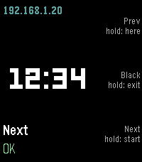

<!-- Generated by scripts/update_app_directory.py: do not edit by hand -->
[← All Pebble Developers](../developers.md)

# Turbo Crystal-Gazer

*1 app · Last updated 2026-10-19 · [About these lists](../about-app-lists.md)*

Links: [Pebble App Store](https://apps.repebble.com/apps/dev/turbo-crystal-gazer_203cdfe92e1524a81fdc63bb) · [GitHub (Rucolastico)](https://github.com/Rucolastico)

<h2 class="app-name" id="app-4b99f08452124d629e2b57c7"><a href="https://apps.repebble.com/4b99f08452124d629e2b57c7">Apuntador</a> v1.0.0</h2>
<a class="app-source" href="https://github.com/Rucolastico/pebble-apuntador" title="Source code" data-search-exclude>View source</a>

App

MIT Released 2026-10-13 Updated 2026-10-13

Runs on: Round 2, Time 2, Pebble 2 Duo, Pebble 2, Time Round, Time, Classic

Control your slides from your wrist. Apuntador turns your Pebble into a presentation remote for a Linux computer (PowerPoint, LibreOffice Impress or OnlyOffice). • Down / Up: next / previous slide…

