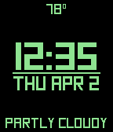
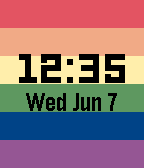
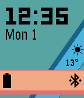
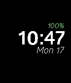
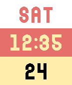

<!-- Generated by scripts/update_app_directory.py: do not edit by hand -->
[← All Pebble Developers](../developers.md)

# Turner Vink

*7 watchfaces · Last updated 2026-10-11 · [About these lists](../about-app-lists.md)*

Links: [Pebble App Store](https://apps.repebble.com/apps/dev/turner-vink_54a871aadf4908b0410000f1) · [GitHub (turnervink)](https://github.com/turnervink) · [Website (turnervink.com)](http://www.turnervink.com)

<button type="button" data-filter="all" aria-pressed="true">All 7</button><button type="button" data-filter="watchface" aria-pressed="false">Watchfaces 7</button><button type="button" data-filter="watchapp" aria-pressed="false" disabled>Apps 0</button>

<label class="dev-sort">Sort by <select><option value="updated">Recently updated</option><option value="released">Newest release</option><option value="title">A–Z</option></select></label>

<h2 class="app-name" id="app-552597c506e80c0a4b00007f"><a href="https://apps.repebble.com/552597c506e80c0a4b00007f">Square</a> v5.7</h2>
<a class="app-source" href="https://github.com/turnervink/square" title="Source code" data-search-exclude>View source</a>

Watchface

Released 2015-04-08 Updated 2017-09-04

Runs on: Round 2, Time 2, Pebble 2 Duo, Pebble 2, Time Round, Time, Classic

Square is a clean looking watchface packed with tons of features! If you enjoy it, leave a heart and consider donating through the link on the settings page! - Offline configuration with Clay …

<h2 class="app-name" id="app-5952a9850dfc32acc70003dd"><a href="https://apps.repebble.com/5952a9850dfc32acc70003dd">Pride</a> v1.0</h2>
<a class="app-source" href="https://github.com/turnervink/prideface" title="Source code" data-search-exclude>View source</a>

Watchface

Released 2017-06-27 Updated 2017-06-27

Runs on: Round 2, Time 2, Time Round, Time

Wear your pride on your sleeve with this watchface! Features configurable pride flags. Don&#x27;t see your flag? Use the contact developer button to request one!

<h2 class="app-name" id="app-565fdd4a0ea7f7eaa9000008"><a href="https://apps.repebble.com/565fdd4a0ea7f7eaa9000008">Undertime</a> v1.3</h2>
<a class="app-source" href="https://github.com/turnervink/undertime" title="Source code" data-search-exclude>View source</a>

Watchface

Released 2015-12-03 Updated 2017-01-07

Runs on: Time 2, Pebble 2 Duo, Pebble 2, Time, Classic

Checking the time... it fills you with DETERMINATION. A new Undertale character every hour or every time you launch the watchface. The health bar empties if your watch disconnects from your phone…

<h2 class="app-name" id="app-56afc52e3076f5d16e000050"><a href="https://apps.repebble.com/56afc52e3076f5d16e000050">Material Ribbon</a> v1.3</h2>
<a class="app-source" href="https://github.com/turnervink/materialribbon" title="Source code" data-search-exclude>View source</a>

Watchface

Released 2016-02-01 Updated 2016-03-16

Runs on: Round 2, Time 2, Time Round, Time

If you enjoy Material Ribbon, give it a heart or consider making a donation through the settings page! Inspired by Material Design, Material Ribbon gives you all the information you need on two…

<h2 class="app-name" id="app-5510e098daf205460f000079"><a href="https://apps.repebble.com/5510e098daf205460f000079">Glober Bold</a> v3.3</h2>
<a class="app-source" href="https://github.com/turnervink/globerbold" title="Source code" data-search-exclude>View source</a>

Watchface

Released 2015-03-24 Updated 2015-10-29

Runs on: Time 2, Pebble 2 Duo, Pebble 2, Time, Classic

A simple watchface using the beautiful font Glober. See the time, date, battery level, and weather. The battery level can be hidden, and the weather can either be shown all the time or when you…

<h2 class="app-name" id="app-562c54436edde4d185000031"><a href="https://apps.repebble.com/562c54436edde4d185000031">Candy Corn</a> v1.0</h2>
<a class="app-source" href="https://github.com/turnervink/candycorn" title="Source code" data-search-exclude>View source</a>

Watchface

Released 2015-10-25 Updated 2015-10-25

Runs on: Round 2, Time 2, Time Round, Time

Some people say candy corn is the worst Halloween candy. Show that you don&#x27;t care what they say with this delicious watchface! Layout is weekday, time, and date.

<h2 class="app-name" id="app-553047687b5ea6980a00006a"><a href="https://apps.repebble.com/553047687b5ea6980a00006a">Vacation Time</a> v3.1</h2>
<a class="app-source" href="https://github.com/turnervink/vacationtime" title="Source code" data-search-exclude>View source</a>

Watchface

Released 2015-04-16 Updated 2015-08-30

Runs on: Time 2, Pebble 2 Duo, Pebble 2, Time, Classic

For when the hours don&#x27;t matter! See the progress through the day in 8 easy to read stages. Shake to view remaining battery, current &quot;feels-like&quot; temperature, and hourly forecast. Stages: midnight…

