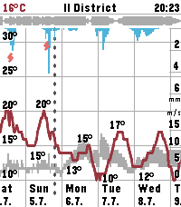
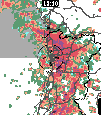
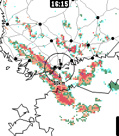

<!-- Generated by scripts/update_app_directory.py: do not edit by hand -->
[← All Pebble Developers](../developers.md)

# Tuukka Ruhanen

*1 watchface and 5 apps · Last updated 2026-10-11 · [About these lists](../about-app-lists.md)*

Links: [Pebble App Store](https://apps.repebble.com/apps/dev/tuukka-ruhanen_2a1ec999749817a461025038) · [GitHub (truhanen)](https://github.com/truhanen)

<button type="button" data-filter="all" aria-pressed="true">All 6</button><button type="button" data-filter="watchface" aria-pressed="false">Watchfaces 1</button><button type="button" data-filter="watchapp" aria-pressed="false">Apps 5</button>

<label class="dev-sort">Sort by <select><option value="updated">Recently updated</option><option value="released">Newest release</option><option value="title">A–Z</option></select></label>

<h2 class="app-name" id="app-40ec229ff6dc4188841a514f"><a href="https://apps.repebble.com/40ec229ff6dc4188841a514f">Sae Weather Graph</a> v1.8.0</h2>
<a class="app-source" href="https://github.com/truhanen/pebble-sae-weather-graph" title="Source code" data-search-exclude>View source</a>

App

Released 2026-06-24 Updated 2026-09-02

Runs on: Time 2

Highly informative weather forecast graph for Pebble Time 2. The only weather app you&#x27;ll ever need! Sää [ˈs̠æː] is Finnish for weather. Sae is Finnish for rain. The app works globally. Displays 10…

<h2 class="app-name" id="app-d42063edd3194272807c7eeb"><a href="https://apps.repebble.com/d42063edd3194272807c7eeb">Rain Map</a> v2.1.1</h2>
<a class="app-source" href="https://github.com/truhanen/pebble-rain-map" title="Source code" data-search-exclude>View source</a>

App

Released 2026-08-26 Updated 2026-08-27

Runs on: Time 2

App for viewing recent rain radar data. For the most accurate near-future rain forecast. The app features proximity-based resolution, to give you the most detailed data closest to your location…

<h2 class="app-name" id="app-e4942ade58a44968bae74b35"><a href="https://apps.repebble.com/e4942ade58a44968bae74b35">Another Timer</a> v2.2.1</h2>
<a class="app-source" href="https://github.com/truhanen/pebble-another-timer" title="Source code" data-search-exclude>View source</a>

App

Released 2026-07-21 Updated 2026-08-21

Runs on: Time 2

Yet another timer app, built for fast, versatile, &amp; straightforward usage. Features: - Instantly start timers by one touch - Multiple timers - Reusable saved timers - Timer labels - Track…

<h2 class="app-name" id="app-07c6afdd062141c19bf72312"><a href="https://apps.repebble.com/07c6afdd062141c19bf72312">Another Alarm</a> v2.3.1</h2>
<a class="app-source" href="https://github.com/truhanen/pebble-another-alarm" title="Source code" data-search-exclude>View source</a>

App

Released 2026-07-28 Updated 2026-08-09

Runs on: Time 2

Yet another alarm app, with cron mode for maximum flexibility, and many other useful features. Features - Alarm sound &amp; vibration - Increasing alarm volume - Snooze - Multiple alarms - Labeled…

<h2 class="app-name" id="app-60a7dd07a44f475998f61c31"><a href="https://apps.repebble.com/60a7dd07a44f475998f61c31">Nyquist</a> v1.3.0</h2>
<a class="app-source" href="https://github.com/truhanen/pebble-nyquist-watchface" title="Source code" data-search-exclude>View source</a>

Watchface

Released 2026-06-28 Updated 2026-07-02

Runs on: Round 2, Time 2

Readable analog watchface with bold hands, weather, battery, and date. Configuration options - Show/hide corner elements (Pebble Time 2 only) - Invert black/white colors - Time format 24h/12h

<h2 class="app-name" id="app-02d34a66846d4bd89c300ae6"><a href="https://apps.repebble.com/02d34a66846d4bd89c300ae6">Rain Map Finland</a> v1.4.0</h2>
<a class="app-source" href="https://github.com/truhanen/pebble-rain-map-finland" title="Source code" data-search-exclude>View source</a>

App

Released 2026-04-05 Updated 2026-06-04

Runs on: Time 2

App for viewing recent rain radar data in Finland. For the most accurate rain forecast. This is an earlier, Finland-only version of my other app, Rain Map. Rain Map has all the same features, and…

