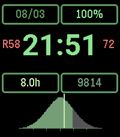

<!-- Generated by scripts/update_app_directory.py: do not edit by hand -->
[← All Pebble Developers](../developers.md)

# Tybbs

*2 watchfaces · Last updated 2026-10-12 · [About these lists](../about-app-lists.md)*

Links: [Pebble App Store](https://apps.repebble.com/apps/dev/tybbs_69dd7d76d75323000858be76) · [GitHub (TybbsTheUnfocused)](https://github.com/TybbsTheUnfocused) · [Website (elliotkennedy.org)](https://elliotkennedy.org)

<button type="button" data-filter="all" aria-pressed="true">All 2</button><button type="button" data-filter="watchface" aria-pressed="false">Watchfaces 2</button><button type="button" data-filter="watchapp" aria-pressed="false" disabled>Apps 0</button>

<label class="dev-sort">Sort by <select><option value="updated">Recently updated</option><option value="released">Newest release</option><option value="title">A–Z</option></select></label>

<h2 class="app-name" id="app-181f2f52c7e3427c9d603298"><a href="https://apps.repebble.com/181f2f52c7e3427c9d603298">Solarized Statistician</a> v1.0.0</h2>
<a class="app-source" href="https://github.com/TybbsTheUnfocused/solarized_statistician" title="Source code" data-search-exclude>View source</a>

Watchface

No licence Released 2026-08-03 Updated 2026-08-03

Runs on: Time 2, Time

Solarized Statistician treats your day like a dataset. Instead of a plain step counter, it plots today&#x27;s steps as the filled area under a normal distribution, so a glance tells you where today…

<h2 class="app-name" id="app-69dd9b7077602b0009e99a04"><a href="https://apps.repebble.com/69dd9b7077602b0009e99a04">Tessera ad Infinitum</a> v1.0</h2>
<a class="app-source" href="https://github.com/TybbsTheUnfocused/tessera_infinitum_watchface" title="Source code" data-search-exclude>View source</a>

Watchface · <a href="https://forum.rebble.io/t/873" title="Discuss this app on the Rebble forum" data-search-exclude>Forum thread</a>

No licence Released 2026-04-14 Updated 2026-04-14

Runs on: Round 2, Time 2, Time Round, Time

Tessera ad Infinitum transforms your Pebble into a window to an ever-changing world of generative art. Every hour, a new slice of a procedurally generated canvas is fetched and displayed as your…

