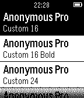

<!-- Generated by scripts/update_app_directory.py: do not edit by hand -->
[← All Pebble Developers](../developers.md)

# Tyler Akins

*1 app · Last updated 2026-10-11 · [About these lists](../about-app-lists.md)*

Links: [Pebble App Store](https://apps.repebble.com/apps/dev/tyler-akins_5494f3191a0bb14ead000060) · [GitHub (fidian)](https://github.com/fidian)

<h2 class="app-name" id="app-5498fac473268fc7d4000077"><a href="https://apps.repebble.com/5498fac473268fc7d4000077">Fontastic</a> v1.3</h2>
<a class="app-source" href="http://github.com/fidian/pebble-fontastic" title="Source code" data-search-exclude>View source</a>

App

MIT Released 2014-12-23 Updated 2014-12-28

Runs on: Time 2, Pebble 2 Duo, Pebble 2, Time, Classic

Preview how fonts are displayed on the Pebble. Aimed at developers with the goal of helping them decide if their app should use a built-in font or one of the more popular custom fonts. Includes…

