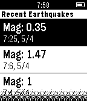

<!-- Generated by scripts/update_app_directory.py: do not edit by hand -->
[← All Pebble Developers](../developers.md)

# Tyler Ouyang

*2 apps · Last updated 2026-10-12 · [About these lists](../about-app-lists.md)*

Links: [Rebble App Store](https://apps.rebble.io/en_US/developer/551fa6c651d7438f9200000a/1) · [Pebble App Store](https://apps.repebble.com/apps/dev/tyler-ouyang_551fa6c651d7438f9200000a) · [GitHub (tylerwowen)](https://github.com/tylerwowen) · [Website (tylerwowen.github.io)](http://tylerwowen.github.io/wechatbuddy/)

<button type="button" data-filter="all" aria-pressed="true">All 2</button><button type="button" data-filter="watchface" aria-pressed="false" disabled>Watchfaces 0</button><button type="button" data-filter="watchapp" aria-pressed="false">Apps 2</button>

<label class="dev-sort">Sort by <select><option value="updated">Recently updated</option><option value="released">Newest release</option><option value="title">A–Z</option></select></label>

<h2 class="app-name" id="app-55c712656b4abe9e19000069"><a href="https://apps.rebble.io/en_US/application/55c712656b4abe9e19000069">QRBuddy for Pebble</a> v1.3</h2>
<a class="app-source" href="https://github.com/tylerwowen/wechatbuddy" title="Source code" data-search-exclude>View source</a>

App

Released 2015-08-09 Updated 2015-10-04 Rebble App Store

Runs on: Time 2, Pebble 2 Duo, Pebble 2, Time, Classic

Show your QR code on your wrist in a second. 1. Install iOS app &#x27;QRBuddy for Pebble&#x27; 2. Install Pebble Watchapp &#x27;QRBuddy for Pebble&#x27; 3. Save your QR code to your Photo Library, or you can take a…

<h2 class="app-name" id="app-5530b9f67b5ea6a2380000e1"><a href="https://apps.repebble.com/5530b9f67b5ea6a2380000e1">Earthquake!!</a> v1.0</h2>
<a class="app-source" href="https://github.com/tylerwowen/pebblequake" title="Source code" data-search-exclude>View source</a>

App

Released 2015-04-17 Updated 2015-04-17

Runs on: Time 2, Pebble 2 Duo, Pebble 2, Time, Classic

A Watchapp that shows the newest earthquake information ranging from N30 to N45, W112 to W130 (California and its surrounding areas). The data is from USGS 1. Shows the newest 6 entries 2. Updates…

