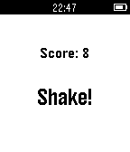

<!-- Generated by scripts/update_app_directory.py: do not edit by hand -->
[← All Pebble Developers](../developers.md)

# Tyler Riedal

*1 watchface and 1 app · Last updated 2026-10-12 · [About these lists](../about-app-lists.md)*

Links: [Pebble App Store](https://apps.repebble.com/apps/dev/tyler-riedal_54e6b031b3b8c3b10000002e) · [GitHub (triedal)](https://github.com/triedal) · [Website (tylerried.al)](http://tylerried.al)

<button type="button" data-filter="all" aria-pressed="true">All 2</button><button type="button" data-filter="watchface" aria-pressed="false">Watchfaces 1</button><button type="button" data-filter="watchapp" aria-pressed="false">Apps 1</button>

<label class="dev-sort">Sort by <select><option value="updated">Recently updated</option><option value="released">Newest release</option><option value="title">A–Z</option></select></label>

<h2 class="app-name" id="app-54f7c4a2feb37edcfb0000b5"><a href="https://apps.repebble.com/54f7c4a2feb37edcfb0000b5">Countdown</a> v1.1</h2>
<a class="app-source" href="https://github.com/triedal/countdown" title="Source code" data-search-exclude>View source</a>

Watchface

Released 2015-03-05 Updated 2015-04-03

Runs on: Time 2, Pebble 2 Duo, Pebble 2, Time, Classic

Countdown visually displays how much time is left in your day. It also gives the current temperature (currently only in Fahrenheit).

<h2 class="app-name" id="app-55079bdbce75c114d30000c7"><a href="https://apps.repebble.com/55079bdbce75c114d30000c7">Shake It!</a> v1.0</h2>
<a class="app-source" href="https://github.com/triedal/Shake-It" title="Source code" data-search-exclude>View source</a>

App

Released 2015-03-17 Updated 2015-03-17

Runs on: Time 2, Pebble 2 Duo, Pebble 2, Time, Classic

Bop It clone for Pebble! Get ready to react fast! Mimic the displayed commands by using the side buttons and shaking your watch.

