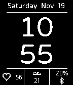

<!-- Generated by scripts/update_app_directory.py: do not edit by hand -->
[← All Pebble Developers](../developers.md)

# tylerherzog

*1 watchface · Last updated 2026-10-12 · [About these lists](../about-app-lists.md)*

Links: [Pebble App Store](https://apps.repebble.com/apps/dev/tylerherzog_52f01cc4af0eab12840004eb) · [GitHub (tylerherzog1)](https://github.com/tylerherzog1)

<h2 class="app-name" id="app-5833b4a000355a2f3a0001cf"><a href="https://apps.repebble.com/5833b4a000355a2f3a0001cf">Daily Stats</a> v1.0</h2>
<a class="app-source" href="https://github.com/tylerherzog1/Pebble/blob" title="Source code" data-search-exclude>View source</a>

Watchface

Released 2016-11-22 Updated 2017-04-22

Runs on: Time 2, Pebble 2 Duo, Pebble 2

Simple, efficient, and only the info you need. Designed as a project for my wife and her new Pebble2. Includes: Heart rate, step count, battery %, time, date, and bluetooth connection indicator…

