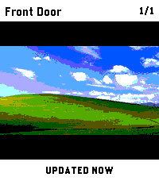
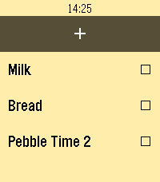

<!-- Generated by scripts/update_app_directory.py: do not edit by hand -->
[← All Pebble Developers](../developers.md)

# tylxr

*2 apps · Last updated 2026-10-11 · [About these lists](../about-app-lists.md)*

Links: [Pebble App Store](https://apps.repebble.com/apps/dev/tylxr_733c943276de33fbfd3f2f37) · [GitHub (tylxr59)](https://github.com/tylxr59)

<button type="button" data-filter="all" aria-pressed="true">All 2</button><button type="button" data-filter="watchface" aria-pressed="false" disabled>Watchfaces 0</button><button type="button" data-filter="watchapp" aria-pressed="false">Apps 2</button>

<label class="dev-sort">Sort by <select><option value="updated">Recently updated</option><option value="released">Newest release</option><option value="title">A–Z</option></select></label>

<h2 class="app-name" id="app-789d24302fcd416ab4f68cf4"><a href="https://apps.repebble.com/789d24302fcd416ab4f68cf4">PinHole</a> v1.2.2</h2>
<a class="app-source" href="https://github.com/tylxr59/PinHole" title="Source code" data-search-exclude>View source</a>

App

Released 2026-05-26 Updated 2026-07-20

Runs on: Time 2

PinHole lets you quickly check go2rtc camera snapshots from your Pebble Time 2. Use the hardware buttons to switch between up to six configured cameras, then press SELECT to refresh the current…

<h2 class="app-name" id="app-6f7de6d295fa464aa9bc7ab8"><a href="https://apps.repebble.com/6f7de6d295fa464aa9bc7ab8">getme for Pebble</a> v1.0</h2>
<a class="app-source" href="https://github.com/tylxr59/getme-for-pebble" title="Source code" data-search-exclude>View source</a>

App

Released 2026-05-27 Updated 2026-05-27

Runs on: Time 2

Keep your self-hosted getme grocery list on your wrist. getme for Pebble brings a fast, button-first checklist experience to Pebble, backed by your own getme server. Sync your list from your…

