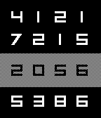

<!-- Generated by scripts/update_app_directory.py: do not edit by hand -->
[← All Pebble Developers](../developers.md)

# Ugo Raffaele Piemontese

*2 watchfaces and 1 app · Last updated 2026-10-11 · [About these lists](../about-app-lists.md)*

Links: [Pebble App Store](https://apps.repebble.com/apps/dev/ugo-raffaele-piemontese_54a54a335d5a91a9d300005e) · [GitHub (UgoRaffaele)](https://github.com/UgoRaffaele) · [Website (ugopiemontese.eu)](http://www.ugopiemontese.eu)

<button type="button" data-filter="all" aria-pressed="true">All 3</button><button type="button" data-filter="watchface" aria-pressed="false">Watchfaces 2</button><button type="button" data-filter="watchapp" aria-pressed="false">Apps 1</button>

<label class="dev-sort">Sort by <select><option value="updated">Recently updated</option><option value="released">Newest release</option><option value="title">A–Z</option></select></label>

<h2 class="app-name" id="app-5509840784ad023da7000009"><a href="https://apps.repebble.com/5509840784ad023da7000009">HelpAnyTime</a> v1.0</h2>
<a class="app-source" href="https://github.com/UgoRaffaele/HelpAnyTime-pebble" title="Source code" data-search-exclude>View source</a>

App

GPL-3.0 Released 2015-03-18 Updated 2015-03-19

Runs on: Time 2, Pebble 2 Duo, Pebble 2, Time, Classic

Emergency alerts directly on your phone (companion app needed). For example, give your Pebble to your grandma and go to sleep, she will be able to wake you up immediately just by pressing a…

<h2 class="app-name" id="app-54ece483b5dab688970000b8"><a href="https://apps.repebble.com/54ece483b5dab688970000b8">Digits</a> v1.0</h2>
<a class="app-source" href="https://github.com/UgoRaffaele/Digits-pebble" title="Source code" data-search-exclude>View source</a>

Watchface

GPL-3.0 Released 2015-02-24 Updated 2015-02-24

Runs on: Time 2, Pebble 2 Duo, Pebble 2, Time, Classic

Vaguely inspired by Pebble Time new watchfaces. The hour is highlighted by a simple, grey background, while white digits all around are randomly displayed all around. Credits: the &quot;Inversionz&quot;…

<h2 class="app-name" id="app-54d2072b2a56ee21ec000092"><a href="https://apps.repebble.com/54d2072b2a56ee21ec000092">hackS1GN</a> v2.0</h2>
<a class="app-source" href="https://github.com/UgoRaffaele/hackS1GN-pebble" title="Source code" data-search-exclude>View source</a>

Watchface

GPL-3.0 Released 2015-02-04 Updated 2015-02-13

Runs on: Time 2, Pebble 2 Duo, Pebble 2, Time, Classic

My watchface, created for fun. The date is in binary 24-hour format. Hour on column 1, minutes on column 2, day on column 3 and month on column 4, from top to bottom. 1st screenshot, 12:17 of…

