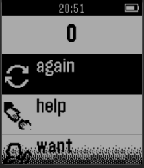

<!-- Generated by scripts/update_app_directory.py: do not edit by hand -->
[← All Pebble Developers](../developers.md)

# UIUC Bioengineering

*1 app · Last updated 2026-10-12 · [About these lists](../about-app-lists.md)*

Links: [Pebble App Store](https://apps.repebble.com/apps/dev/uiuc-bioengineering_5542a00380f0ad0d610000bc) · [GitHub (Utsav2)](https://github.com/Utsav2) · [Website (play.google.com)](https://play.google.com/store/apps/details?id=utsav2.researchproject)

<h2 class="app-name" id="app-557824714f8d9860dc00001b"><a href="https://apps.repebble.com/557824714f8d9860dc00001b">Pebble Speak Easy AAC App</a> v1.0</h2>
<a class="app-source" href="https://github.com/Utsav2/PebbleAndroid" title="Source code" data-search-exclude>View source</a>

App

No licence Released 2015-06-10 Updated 2015-06-19

Runs on: Time 2, Pebble 2 Duo, Pebble 2, Time, Classic

Pebble Speak Easy is an AAC App designed to make communication simple and customizable. The purpose of this app is to enable easy, quick, and human communication with loved ones. The speaker wears…

