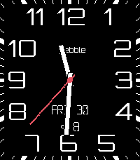

<!-- Generated by scripts/update_app_directory.py: do not edit by hand -->
[← All Pebble Developers](../developers.md)

# Łukasz Zalewski

*2 watchfaces · Last updated 2026-11-09 · [About these lists](../about-app-lists.md)*

Links: [Pebble App Store](https://apps.repebble.com/apps/dev/ukasz-zalewski_5299dfb9129af7a225000093) · [GitHub (zalewszczak)](https://github.com/zalewszczak)

<button type="button" data-filter="all" aria-pressed="true">All 2</button><button type="button" data-filter="watchface" aria-pressed="false">Watchfaces 2</button><button type="button" data-filter="watchapp" aria-pressed="false" disabled>Apps 0</button>

<label class="dev-sort">Sort by <select><option value="updated">Recently updated</option><option value="released">Newest release</option><option value="title">A–Z</option></select></label>

<h2 class="app-name" id="app-52bb213af9846878c200015b"><a href="https://apps.repebble.com/52bb213af9846878c200015b">Modern</a> v4.0.5</h2>
<a class="app-source" href="https://github.com/zalewszczak/pebble-modern-watchface" title="Source code" data-search-exclude>View source</a>

Watchface

No licence Released 2013-12-25 Updated 2026-11-09

Runs on: Round 2, Time 2, Pebble 2 Duo, Pebble 2

!!! ROUND USERS: This is an alpha build preview, not a finalized round port of modern - even the design is experimental. I&#x27;ll be working through the bugs, UI and UX over next couple weeks. Thank…

<h2 class="app-name" id="app-2433a070bb7d46b9b7f84e7f"><a href="https://apps.repebble.com/2433a070bb7d46b9b7f84e7f">Eclipz</a> v1.4.2</h2>
<a class="app-source" href="https://github.com/zalewszczak/solar-eclipse-watch" title="Source code" data-search-exclude>View source</a>

Watchface

No licence Released 2026-09-25 Updated 2026-11-06

Runs on: Time 2

What is a a watch? We&#x27;ve used them for decades without asking this basic question, what exactly does it do? You would think it just tells the time, but in reality it tracks the movement of…

