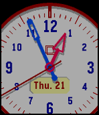

<!-- Generated by scripts/update_app_directory.py: do not edit by hand -->
[← All Pebble Developers](../developers.md)

# uKuYu

*1 watchface · Last updated 2026-10-12 · [About these lists](../about-app-lists.md)*

Links: [Pebble App Store](https://apps.repebble.com/apps/dev/ukuyu_53565fdcea2f16e05600000c) · [GitHub (JorgeRionegro)](https://github.com/JorgeRionegro)

<h2 class="app-name" id="app-55009e88b5bebe256900003a"><a href="https://apps.repebble.com/55009e88b5bebe256900003a">Titan</a> v8.23</h2>
<a class="app-source" href="https://github.com/JorgeRionegro/Titan-PebbleTimeWatchFace" title="Source code" data-search-exclude>View source</a>

Watchface

No licence Released 2015-03-11 Updated 2015-10-22

Runs on: Round 2, Time 2, Pebble 2 Duo, Pebble 2, Time Round, Time, Classic

WHO WANTS A ROUND WATCH HAVING A FABULOUS SQUARE ONE WITH A BIG ROUND INSIDE? Highly configurable analog Clock with multiple configuration options. Made your own clock. - Now you can change…

