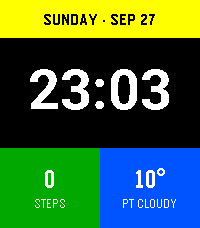

<!-- Generated by scripts/update_app_directory.py: do not edit by hand -->
[← All Pebble Developers](../developers.md)

# Uldis Bojars

*1 watchface · Last updated 2026-10-11 · [About these lists](../about-app-lists.md)*

Links: [Pebble App Store](https://apps.repebble.com/apps/dev/uldis-bojars_c6f5fff2fdd5283c36d0acf1) · [GitHub (CaptSolo)](https://github.com/CaptSolo)

<h2 class="app-name" id="app-cb565b88dbf04db5a5e693c8"><a href="https://apps.repebble.com/cb565b88dbf04db5a5e693c8">BigTime CS</a> v1.0.0</h2>
<a class="app-source" href="https://github.com/CaptSolo/BigTime-CS" title="Source code" data-search-exclude>View source</a>

Watchface

MIT Released 2026-09-27 Updated 2026-09-27

Runs on: Time 2

Bold, colorful watchface for Pebble Time 2 with steps and weather

