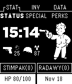
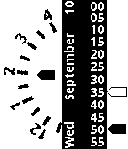

<!-- Generated by scripts/update_app_directory.py: do not edit by hand -->
[← All Pebble Developers](../developers.md)

# unexist

*5 watchfaces · Last updated 2026-10-11 · [About these lists](../about-app-lists.md)*

Links: [Rebble App Store](https://apps.rebble.io/en_US/developer/52b88eac9efe5857ed000041/1) · [Pebble App Store](https://apps.repebble.com/apps/dev/unexist_52b88eac9efe5857ed000041) · [Website (subforge.org)](http://subforge.org)

<button type="button" data-filter="all" aria-pressed="true">All 5</button><button type="button" data-filter="watchface" aria-pressed="false">Watchfaces 5</button><button type="button" data-filter="watchapp" aria-pressed="false" disabled>Apps 0</button>

<label class="dev-sort">Sort by <select><option value="updated">Recently updated</option><option value="released">Newest release</option><option value="title">A–Z</option></select></label>

<h2 class="app-name" id="app-585949725de850e8dc00039a"><a href="https://apps.rebble.io/en_US/application/585949725de850e8dc00039a">FirstNight</a> v1.2</h2>
<a class="app-source" href="http://hg.subforge.org/firstnight" title="Source code" data-search-exclude>View source</a>

Watchface

Released 2016-12-20 Updated 2016-12-23 Rebble App Store

Runs on: Time 2, Pebble 2 Duo, Pebble 2, Time, Classic

This is a watchface for a friend of mine: It shows exactly the same special date until you shake the watch and reveal the real time for 5s.

<h2 class="app-name" id="app-582ef52736ac5aa1be00026c"><a href="https://apps.repebble.com/582ef52736ac5aa1be00026c">Pipboy</a> v1.1</h2>
<a class="app-source" href="http://hg.subforge.org/pipboy" title="Source code" data-search-exclude>View source</a>

Watchface

Released 2016-11-18 Updated 2016-11-18

Runs on: Time 2, Pebble 2 Duo, Pebble 2, Time, Classic

Another watchface that resembles the interface of the famous Pipboy™. Everything is really glued together: -HP gauge is just battery -Ammo a random value of 0-50 when connected to a phone…

<h2 class="app-name" id="app-577f9b6266202a598b0003d9"><a href="https://apps.repebble.com/577f9b6266202a598b0003d9">Flav</a> v1.0</h2>
<a class="app-source" href="http://hg.subforge.org/flav" title="Source code" data-search-exclude>View source</a>

Watchface

Released 2016-07-08 Updated 2016-07-11

Runs on: Time 2, Pebble 2 Duo, Pebble 2, Time, Classic

Just an idea based on a wallpaper I recently found. Basically shows a bunch of clocks with a bit of rotation.

<h2 class="app-name" id="app-540f1c77b8bd034c11000158"><a href="https://apps.repebble.com/540f1c77b8bd034c11000158">Hands</a> v1.1</h2>
<a class="app-source" href="http://hg.subforge.org/hands/" title="Source code" data-search-exclude>View source</a>

Watchface

Released 2014-09-09 Updated 2014-09-10

Runs on: Time 2, Pebble 2 Duo, Pebble 2, Time, Classic

This is a just a weird concept watchface. It shows the current hour in a wheel and the current minutes and seconds with slider-like hands. The filled hand is for minutes, the outlined one for…

<h2 class="app-name" id="app-52b8925a9efe58d51c000046"><a href="https://apps.repebble.com/52b8925a9efe58d51c000046">Hourglass</a> v1.2</h2>
<a class="app-source" href="http://hg.subforge.org/hourglass/" title="Source code" data-search-exclude>View source</a>

Watchface

Released 2013-12-23 Updated 2014-09-09

Runs on: Time 2, Pebble 2 Duo, Pebble 2, Time, Classic

This watchface just displays the outline of a custom font and fills it according to the current time - like a real hourglass. The three horizontal lines are dividers for quarter hours. Currently…

