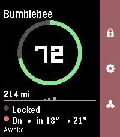

<!-- Generated by scripts/update_app_directory.py: do not edit by hand -->
[← All Pebble Developers](../developers.md)

# Unknown

*1 app · Last updated 2026-10-11 · [About these lists](../about-app-lists.md)*

Links: [Pebble App Store](https://apps.repebble.com/apps/dev/unknown_cd49c75134a78749095da344) · [GitHub (NolanFoster)](https://github.com/NolanFoster)

<h2 class="app-name" id="app-f335b06286af446e9ab3e803"><a href="https://apps.repebble.com/f335b06286af446e9ab3e803">Tesla Control</a> v0.0.1</h2>
<a class="app-source" href="https://github.com/NolanFoster/pebble-tesla" title="Source code" data-search-exclude>View source</a>

App

No licence Released 2026-06-06 Updated 2026-06-06

Runs on: Round 2, Time 2, Pebble 2 Duo, Pebble 2, Time Round, Time

Your Tesla, on your wrist. Tesla Control turns your Pebble into a slim remote for your car. A clean status card shows your vehicle at a glance, and a right-side action bar maps the everyday…

