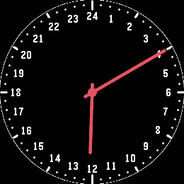

<!-- Generated by scripts/update_app_directory.py: do not edit by hand -->
[← All Pebble Developers](../developers.md)

# Unknown

*1 watchface · Last updated 2026-10-11 · [About these lists](../about-app-lists.md)*

Links: [Pebble App Store](https://apps.repebble.com/apps/dev/unknown_2ebba66a03204551ec2015dc) · [GitHub (cy8aer)](https://github.com/cy8aer)

<h2 class="app-name" id="app-ee99a923ebaf4cf889fef841"><a href="https://apps.repebble.com/ee99a923ebaf4cf889fef841">Watchpebble</a> v1.0.0</h2>
<a class="app-source" href="https://github.com/cy8aer/WatchPebble" title="Source code" data-search-exclude>View source</a>

Watchface

Released 2026-09-20 Updated 2026-09-20

Runs on: Round 2

A 24 hour watchface inspired by an old 24 hour WatchPeople watch.

