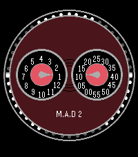

<!-- Generated by scripts/update_app_directory.py: do not edit by hand -->
[← All Pebble Developers](../developers.md)

# Unknown

*1 watchface · Last updated 2026-10-11 · [About these lists](../about-app-lists.md)*

Links: [Pebble App Store](https://apps.repebble.com/apps/dev/unknown_a6e30a264dc5f351d17e51a8) · [GitHub (profweini)](https://github.com/profweini)

<h2 class="app-name" id="app-21086d4ccce74bbbbaedd11a"><a href="https://apps.repebble.com/21086d4ccce74bbbbaedd11a">M.A.D edition 2 watchface</a> v1.5</h2>
<a class="app-source" href="https://github.com/profweini/pebble-mad-watchface" title="Source code" data-search-exclude>View source</a>

Watchface

Released 2026-07-21 Updated 2026-07-21

Runs on: Round 2, Time 2, Pebble 2 Duo, Pebble 2, Time Round, Time, Classic

Mimicks the M.A.D. edition 2 by MB&amp;F. Including: - Jumping hours, smooth minutes - Spinning rotator It works on my Time 2 (2026), Steel (2015), and Classic (2013)

