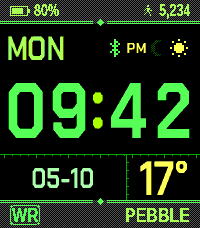

<!-- Generated by scripts/update_app_directory.py: do not edit by hand -->
[← All Pebble Developers](../developers.md)

# Unknown

*1 watchface · Last updated 2026-10-11 · [About these lists](../about-app-lists.md)*

Links: [Pebble App Store](https://apps.repebble.com/apps/dev/unknown_b5c50c2e25385f0ffa3d6c2a) · [GitHub (rohitchannazhi)](https://github.com/rohitchannazhi)

<h2 class="app-name" id="app-98018ad0eadb4fbdabff017b"><a href="https://apps.repebble.com/98018ad0eadb4fbdabff017b">Old digital watch</a> v1.4.0</h2>
<a class="app-source" href="https://github.com/rohitchannazhi/pebble-lcd221EX" title="Source code" data-search-exclude>View source</a>

Watchface

Released 2026-10-09 Updated 2026-10-09

Runs on: Time 2

Only for Time 2. Considering all of the font and margin intricacies. This is a supercharged version of the LCD 221 watch face available from Kicou…

