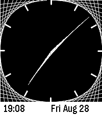

<!-- Generated by scripts/update_app_directory.py: do not edit by hand -->
[← All Pebble Developers](../developers.md)

# unoctium1

*1 watchface · Last updated 2026-10-12 · [About these lists](../about-app-lists.md)*

Links: [Pebble App Store](https://apps.repebble.com/apps/dev/unoctium1_26ff57466b2b8d653880091b) · [GitHub (unoctium1)](https://github.com/unoctium1)

<h2 class="app-name" id="app-36d73649eeed467ab7e37551"><a href="https://apps.repebble.com/36d73649eeed467ab7e37551">Analog Curve Stitch</a> v1.0.0</h2>
<a class="app-source" href="https://github.com/unoctium1/PebbleFaceCurveStitch" title="Source code" data-search-exclude>View source</a>

Watchface

Released 2026-08-29 Updated 2026-08-29

Runs on: Round 2, Time 2

Minimal analog watch face inspired by curve stitching patterns. Includes customizable colors Compatible with Pebble Time 2 &amp; Pebble Round 2

