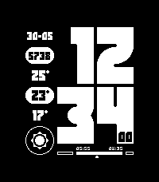

<!-- Generated by scripts/update_app_directory.py: do not edit by hand -->
[← All Pebble Developers](../developers.md)

# Unruh Bros. Print Co.

*1 watchface · Last updated 2026-10-11 · [About these lists](../about-app-lists.md)*

Links: [Pebble App Store](https://apps.repebble.com/apps/dev/unruh-bros-print-co_b6bfb46eef94f16e84d4cd95) · [GitHub (unruh-bros-print-co)](https://github.com/unruh-bros-print-co)

<h2 class="app-name" id="app-723a7e89e3624f45a3e323b5"><a href="https://apps.repebble.com/723a7e89e3624f45a3e323b5">Anticipate</a> v1.2.0</h2>
<a class="app-source" href="https://github.com/unruh-bros-print-co/anticipate" title="Source code" data-search-exclude>View source</a>

Watchface

Released 2026-04-18 Updated 2026-05-31

Runs on: Round 2, Time 2, Pebble 2 Duo, Pebble 2, Time

Anticipate! All the basic information you need to be prepared for the day ahead! Features - Today&#x27;s date - Step Count - Forecasted high temperature - Current temperature - Forecasted low…

