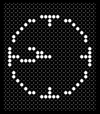

<!-- Generated by scripts/update_app_directory.py: do not edit by hand -->
[← All Pebble Developers](../developers.md)

# V3L

*1 watchface and 1 app · Last updated 2026-10-11 · [About these lists](../about-app-lists.md)*

Links: [Rebble App Store](https://apps.rebble.io/en_US/developer/6903ea5c69551c0009c36237/1) · [GitHub (skooda)](https://github.com/skooda) · [Website (v3l.cz)](https://v3l.cz)

<button type="button" data-filter="all" aria-pressed="true">All 2</button><button type="button" data-filter="watchface" aria-pressed="false">Watchfaces 1</button><button type="button" data-filter="watchapp" aria-pressed="false">Apps 1</button>

<label class="dev-sort">Sort by <select><option value="updated">Recently updated</option><option value="released">Newest release</option><option value="title">A–Z</option></select></label>

<h2 class="app-name" id="app-6935e82b0a850b0009acd5c6"><a href="https://apps.rebble.io/en_US/application/6935e82b0a850b0009acd5c6">Dotty</a> v1.0</h2>
<a class="app-source" href="https://github.com/skooda/pebble-dotty-face" title="Source code" data-search-exclude>View source</a>

Watchface · <a href="https://forum.rebble.io/t/156" title="Discuss this app on the Rebble forum" data-search-exclude>Forum thread</a>

Released 2025-12-07 Updated 2025-12-07 Rebble App Store

Runs on: Round 2, Time 2, Pebble 2 Duo, Pebble 2, Time Round, Time

Minimalistic analog watch face celebrating dots.

<h2 class="app-name" id="app-69207ecd7cdf9d000985e1a7"><a href="https://apps.rebble.io/en_US/application/69207ecd7cdf9d000985e1a7">Horizon</a> v1.0</h2>
<a class="app-source" href="https://github.com/skooda/pebble-horizon" title="Source code" data-search-exclude>View source</a>

App

Released 2025-11-21 Updated 2025-11-21 Rebble App Store

Runs on: Round 2, Time 2, Pebble 2 Duo, Pebble 2, Time Round, Time, Classic

Toy displaying an artificial horizon (attitude indicator) based on accelerometer data. It shows a horizontal line rotated according to the tilt of the watch and includes several graphical elements…

