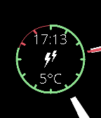

<!-- Generated by scripts/update_app_directory.py: do not edit by hand -->
[← All Pebble Developers](../developers.md)

# Vadim Podlesov

*1 watchface · Last updated 2026-10-11 · [About these lists](../about-app-lists.md)*

Links: [Pebble App Store](https://apps.repebble.com/apps/dev/vadim-podlesov_531ae737c5f2c54076000094) · [GitHub (voseldop)](https://github.com/voseldop)

<h2 class="app-name" id="app-581896d9c68d0087f800005f"><a href="https://apps.repebble.com/581896d9c68d0087f800005f">Shards</a> v1.2</h2>
<a class="app-source" href="https://github.com/voseldop/shards" title="Source code" data-search-exclude>View source</a>

Watchface

Released 2016-11-01 Updated 2016-11-24

Runs on: Round 2, Time 2, Pebble 2 Duo, Pebble 2, Time Round, Time, Classic

Summary: Watchface with battery meter, digital and analog time and weather. The digital time, weather conditions and current temperature is displayed in the center of watchface. The circle in…

