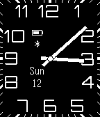

<!-- Generated by scripts/update_app_directory.py: do not edit by hand -->
[← All Pebble Developers](../developers.md)

# Vadim Zaliva

*1 watchface · Last updated 2026-10-11 · [About these lists](../about-app-lists.md)*

Links: [Pebble App Store](https://apps.repebble.com/apps/dev/vadim-zaliva_52facf2e68e48cb2ba00018a) · [GitHub (vzaliva)](https://github.com/vzaliva) · [Website (codeminders.com)](http://www.codeminders.com/)

<h2 class="app-name" id="app-55a2e7632965f287c3000070"><a href="https://apps.repebble.com/55a2e7632965f287c3000070">Modern Chaser</a> v1.0</h2>
<a class="app-source" href="https://github.com/vzaliva/ModernChaser" title="Source code" data-search-exclude>View source</a>

Watchface

Released 2015-07-12 Updated 2015-07-13

Runs on: Time 2, Pebble 2 Duo, Pebble 2, Time, Classic

A variant of Modern watchface where date, bluetooth and battery status windows are never obscured by watch hands. They move around to unobscured position.

